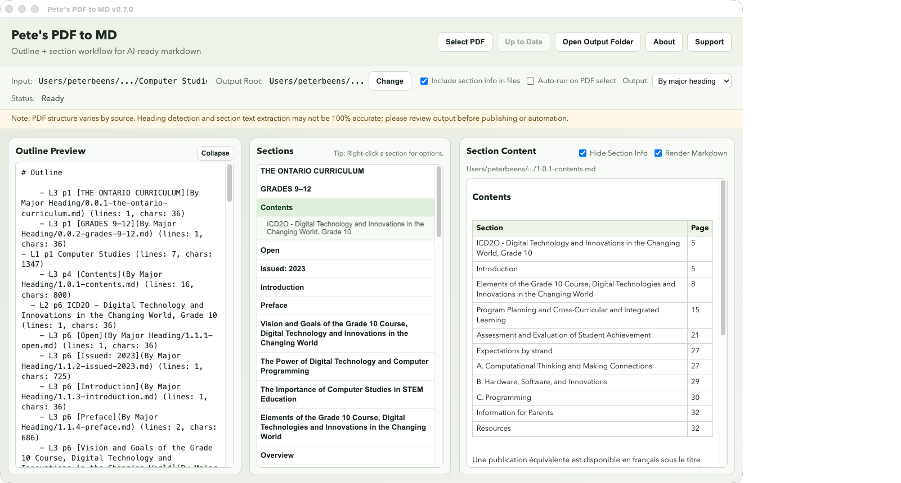

# Pete's PDF to MD

Turn PDF documents into clean Markdown that AI tools can read well, split by the document's own headings.

**Download:** [GitHub Releases](https://github.com/pbeens/Petes-PDF-to-MD/releases) · **User guide:** [peter.beens.ca/Petes-PDF-to-MD](https://peter.beens.ca/Petes-PDF-to-MD/)

<p align="center">
  <a href="docs/images/app-screenshot.png" target="_blank" rel="noopener noreferrer">
    
  </a>
</p>

## Current Version

`v1.0`, a complete rebuild in Rust. See [`CHANGELOG.md`](CHANGELOG.md).

- **Nothing to install.** One app, about 6 MB to download. No Python, no add-ons, no Terminal.
- **Fast.** A 242-page book converts in about 2 seconds.
- **Finds the real headings** from the PDF's bookmarks or accessibility tags, or works them out from the text.
- **Three ways to split the result:** **One file**, **By major heading**, or **Individual sections** (one file per heading).
- **Your choice of output folder.** Files go to `Documents/Pete's PDF to MD Output` unless you pick another folder.
- **Clean text:** tables rebuilt, running headers and page numbers removed, footnotes collected at the end of each section, sentences split by page breaks rejoined, two-column pages read in order, bold, italics and links kept.
- **Private.** Everything runs on your computer.

### What makes it different

Most PDF-to-Markdown converters produce one long file. This one splits the document along its **own headings**, so you can hand an AI tool exactly the chapter or section you need:

- **One file**, **By major heading** (one file per chapter or part), or **Individual sections** (one file per heading).
- Section files are numbered by their place in the outline (`2.1.0.0-introduction.md`), so Finder lists them in reading order.
- `outline.md` links to every file with its page and size; `outline.json` and `segments.json` give programs the same information.
- Heading levels come from the PDF's bookmarks or accessibility tags when it has them, not just font sizes.
- A desktop window to browse the outline and sections right away, and a command-line tool (`npm run convert`) for scripts and batches.

macOS on Apple Silicon. A Windows version is planned.

## Install

1. Download `Pete-s-PDF-to-MD-v1.0-macOS.dmg` from [Releases](https://github.com/pbeens/Petes-PDF-to-MD/releases).
2. Open it and drag **Pete's PDF to MD** into **Applications**.
3. The first time, macOS says it can't verify the app. Open **System Settings → Privacy & Security** and click **Open Anyway**.

## Using the app

- **Select PDF**, or drop a PDF anywhere on the window.
- Choose **Output**: `One file`, `By major heading` or `Individual sections`.
- **Run Conversion**, then browse the outline and sections, or **Open Output Folder**.
- Right-click a section for `Open in folder`, `Open in default program` and `Copy path`.
- **Output Root → Change** picks a different output folder.

For a PDF named `example.pdf`, the output goes to `<output root>/example/`:

- `outline.json`, `outline.md`, `segments.json`: the outline, for people and for programs
- `example.md` (**One file**), `By Major Heading/*.md`, or `Sections/*.md` (**Individual sections**)

The [user guide](https://peter.beens.ca/Petes-PDF-to-MD/) explains every option.

## Build from source

Needs [Rust](https://rustup.rs) (`cargo`) and Node.js 20+ (for the Tauri command-line tool).

```bash
npm install
npm run gui                 # run the app from source
npm run build:mac           # dist/Pete-s-PDF-to-MD-v1.0-macOS.dmg
npm run build:mac:debug     # dist/Pete-s-PDF-to-MD-v1.0b-debug-macOS.dmg
npm test                    # build the converter, then the smoke and regression suites
npm run test:rust           # Rust unit tests and app command tests
```

Command line, without the app:

```bash
npm run convert -- --input "path/to/file.pdf" --out-dir output --conversion-mode single
```

Options: `--out-dir`, `--conversion-mode single|major|sections`, `--include-section-metadata 0|1`, `--out-subdir <folder>`.

**Versions.** Users see `v1.0` (a zero patch number is dropped from `1.0.0`). Every build also advances a revision letter in `package.json` (`buildRevision`). Release builds don't show it. Debug builds do (`v1.0b`): they show "(debug version)" in the title bar and save each conversion in `<PDF name>/v1.0b/`, so results from earlier builds stay side by side. `npm run gui:debug` runs a debug build from source; `npm run version:show` prints the current version.

**Releases.** `npm run release:prep -- --version 1.0.0 --build` checks that `package.json`, the Rust crates, `CHANGELOG.md` and this README agree on the version, then builds the DMG. Upload it to [Releases](https://github.com/pbeens/Petes-PDF-to-MD/releases).

## Repository layout

| Path | What it is |
|---|---|
| `rust/converter/` | The converter: library and command-line tool ([`rust/README.md`](rust/README.md)) |
| `rust/app/` | The desktop app (Tauri) |
| `app/` | The app's window: HTML, CSS, JavaScript |
| `scripts/` | Build, release and test scripts |
| `tests/` | Test cases and plan; test PDFs go in `tests/pdfs/` (not committed) |
| `docs/` | The user guide website ([Quarto](https://quarto.org): `npm run docs:preview`, `npm run docs:render`) |
| `archive/electron-python/` | The Electron app and Python converter used up to v0.9, kept for reference |

## Extraction accuracy

PDFs vary a lot. Headings, section boundaries and text flow may not be exact for every document. The best results come from PDFs with bookmarks or accessibility tags. Scanned PDFs without a text layer need text recognition (OCR) first. Review the output before relying on it.

## Troubleshooting

- **"Apple could not verify…"**: see step 3 under [Install](#install).
- **"Output files are locked by another program"**: close any open section files or previews, then convert again.
- **"invalid/corrupt PDF"**: open the PDF in Preview, export it as a new PDF, and convert that.
- **A section says "(No extractable text in this range.)"**: those pages are images. Run the PDF through OCR first.

More in the [user guide](https://peter.beens.ca/Petes-PDF-to-MD/troubleshooting.html). Report bugs with **Support → Report a Bug** in the app, or on [GitHub Issues](https://github.com/pbeens/Petes-PDF-to-MD/issues), and include the version from the window title.

## License

GPL-3.0. See [`LICENSE`](LICENSE).
