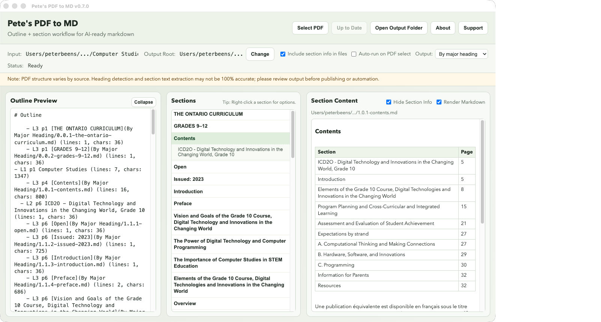

::: {.hero}
::: {.lead}
Pete's PDF to MD is a free, open-source desktop app for macOS (Windows users can run it from the source code). You give it a PDF, such as a report, a manual, a policy or a book, and it produces **Markdown**: plain text with simple marks for headings, lists and tables. It keeps the document's structure, so you can hand the result to ChatGPT, Claude or another AI tool one section at a time.
:::

[Download the latest version](https://github.com/pbeens/Pete-s-PDF-to-MD/releases){.btn .btn-primary .btn-lg role="button"}
[Getting started](getting-started.qmd){.btn .btn-outline-secondary .btn-lg role="button"}
:::

::: {.screenshot}
{fig-alt="Screenshot of Pete's PDF to MD showing the outline, section list and section content panes."}
:::

## What is Markdown, and why convert to it?

**Markdown** is ordinary text with a few symbols that show structure: `#` marks a heading, `-` starts a list item, and rows separated by `|` make a table. Any text editor can open it, and AI tools understand it very well.

A PDF is designed for printing. It records where each letter sits on the page, not which lines are headings or how the text flows. Copying text out of a PDF often gives you broken sentences, page numbers in the middle of paragraphs, and tables that turn into scattered words. Pete's PDF to MD rebuilds the structure for you.

## What it does

::: {.feature-grid}
::: {}
### Finds the real headings
It reads the PDF's bookmarks or accessibility tags, or works out the headings from the text, and builds an outline with proper levels (chapter, section, subsection).
:::

::: {}
### Splits long documents
Save the whole document as one file, one file per major heading, or one file per section, so you can give an AI tool exactly the part you need.
:::

::: {}
### Rebuilds tables
Tables come out as real Markdown tables with the words intact, one row per row and one cell per cell.
:::

::: {}
### Cleans up the text
It removes running headers, page numbers and repeated labels, keeps footnotes together, and joins sentences that a page break split in two.
:::

::: {}
### Fast
A 240-page book converts in under ten seconds on a recent Mac.
:::

::: {}
### Private
Everything runs on your own computer. Your PDFs are never uploaded anywhere.
:::
:::

## Who it's for

Anyone who wants to use long PDF documents with AI tools, or simply get clean, editable text out of a PDF. It works with most PDFs that contain real text, and works best with documents that have clear headings.

::: {.callout-note}
## One thing to know before you start
Download the app from the Releases page; there's nothing to build. The app does need **Python**, a free programming language, installed once on your computer along with a PDF add-on, because Python isn't built into the app yet. [Getting started](getting-started.qmd) walks you through both steps.
:::
