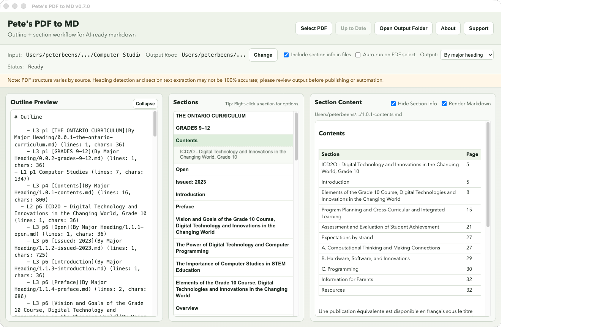

::: {.hero}
::: {.release-badge}
New · Version 1.0
:::

::: {.lead}
**Rebuilt from the ground up in Rust.** Pete's PDF to MD 1.0 is a free, open-source Mac app that turns a PDF, such as a report, a manual, a policy or a book, into **Markdown**: plain text with simple marks for headings, lists and tables. It keeps the document's structure, so you can hand the result to ChatGPT, Claude or another AI tool one section at a time.

Version 1.0 is a 6 MB download with nothing else to install, and it converts a 240-page book in about two seconds.
:::

[Download version 1.0](https://github.com/pbeens/Petes-PDF-to-MD/releases/latest){.btn .btn-primary .btn-lg role="button"}
[Getting started](getting-started.qmd){.btn .btn-outline-secondary .btn-lg role="button"}
:::

::: {.screenshot}
{fig-alt="Screenshot of Pete's PDF to MD 1.0 showing the outline, section list and section content panes."}
:::

## What's new in 1.0

Earlier versions were an Electron app that ran a Python program in the background, so you had to install Python and two add-ons from Terminal before the app would work. Version 1.0 replaces all of it with a single app written in **Rust**, a modern programming language known for speed and reliability.

::: {.stat-grid}
::: {}
[Nothing]{.stat}
to install. No Python, no add-ons, no Terminal.
:::

::: {}
[6 MB]{.stat}
to download, down from 110 MB.
:::

::: {}
[4–15×]{.stat}
faster. About 2 seconds for a 240-page book.
:::
:::

It's better at the hard parts too:

- **Formatting kept.** Bold, italics and links come through, and footnote markers become superscripts.
- **Two-column pages read in order**: the whole left column, then the right.
- **Pull-quotes** (the large quotes set in a box beside the text) become Markdown quotes instead of breaking up the sentence they sat next to.
- **Exported slides and pre-scanned documents** with a hidden text layer are now read, instead of being reported as pictures.
- **Drop a PDF anywhere on the window** to select it.

The [Changelog](changelog.qmd) lists every change.

## What makes it different

Most PDF-to-Markdown converters give you one long file. That's fine for a short document, but a 200-page report pasted into an AI tool in one piece is hard for it to work with, and hard for you to find your way around. Pete's PDF to MD is built around the document's **own structure**:

::: {.feature-grid}
::: {}
### Split by the document's headings
Choose **One file**, **By major heading** (one file per chapter or part) or **Individual sections** (one file per heading). The split follows the headings the author used, not page counts or a fixed size.
:::

::: {}
### Files in reading order
Each section file is numbered by its place in the outline (`2.1.0.0-introduction.md`), so Finder lists them in the document's order, and the name tells you what's inside.
:::

::: {}
### An outline you can follow
Every conversion includes `outline.md`, a heading tree that links to each file and shows its page and size, plus `outline.json` and `segments.json` with the same information for programs and scripts.
:::

::: {}
### The real heading levels
The outline comes from the PDF's bookmarks or accessibility tags when it has them, so chapters, sections and subsections keep their true levels instead of being guessed from font sizes.
:::

::: {}
### A window to browse the result
See the outline and every section as soon as the conversion finishes, read them as plain or formatted Markdown, and right-click to open or copy any file.
:::

::: {}
### Or the command line
The same converter runs from Terminal for scripts and batches, with the same three modes. See [Development](development.qmd#running-from-source).
:::
:::

## What is Markdown, and why convert to it?

**Markdown** is ordinary text with a few symbols that show structure: `#` marks a heading, `-` starts a list item, and rows separated by `|` make a table. Any text editor can open it, and AI tools understand it very well.

A PDF is designed for printing. It records where each letter sits on the page, not which lines are headings or how the text flows. Copying text out of a PDF often gives you broken sentences, page numbers in the middle of paragraphs, and tables that turn into scattered words. Pete's PDF to MD rebuilds the structure for you.

## What it does

::: {.feature-grid}
::: {}
### Finds the real headings
It reads the PDF's bookmarks or accessibility tags, or works out the headings from the text, and builds an outline with proper levels (chapter, section, subsection).
:::

::: {}
### Splits it your way
Choose **One file** for the whole document, **By major heading** for one file per chapter or part, or **Individual sections** for one file per heading, so you can give an AI tool exactly the part you need.
:::

::: {}
### Saves where you want
Results go to **Documents → Pete's PDF to MD Output**, in a folder named after each PDF. Pick any other folder with one click.
:::

::: {}
### Rebuilds tables
Tables come out as real Markdown tables with the words intact, one row per row and one cell per cell.
:::

::: {}
### Cleans up the text
It removes running headers, page numbers and repeated labels, collects footnotes at the end of each section, and joins sentences that a page break split in two.
:::

::: {}
### Private
Everything runs on your own computer. Your PDFs are never uploaded anywhere.
:::
:::

## Who it's for

Anyone who wants to use long PDF documents with AI tools, or simply get clean, editable text out of a PDF. It works with most PDFs that contain real text, and works best with documents that have clear headings.

::: {.callout-note}
## Requirements
A Mac with Apple Silicon (M1 or later). A Windows version is planned.
:::
